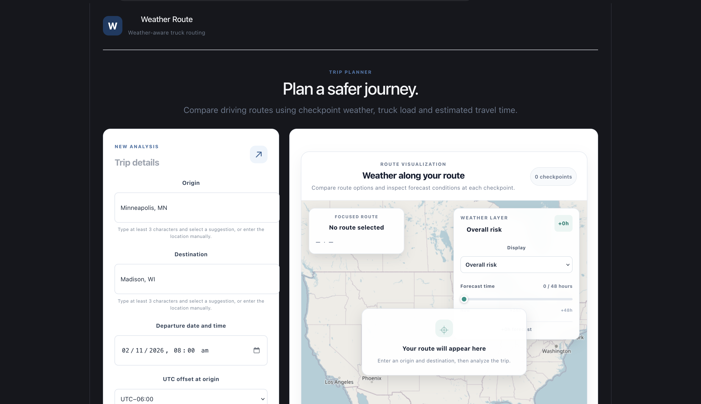
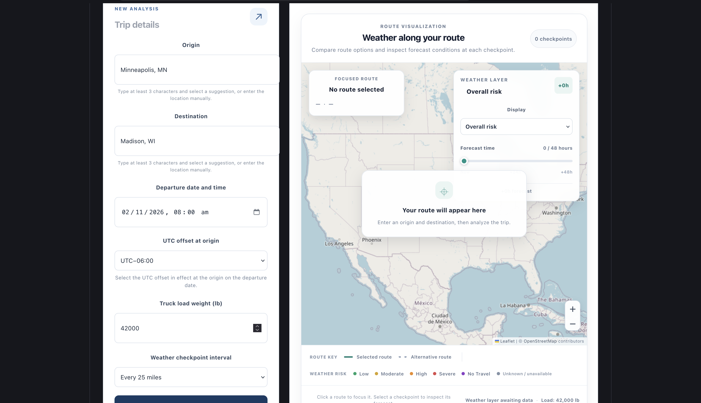
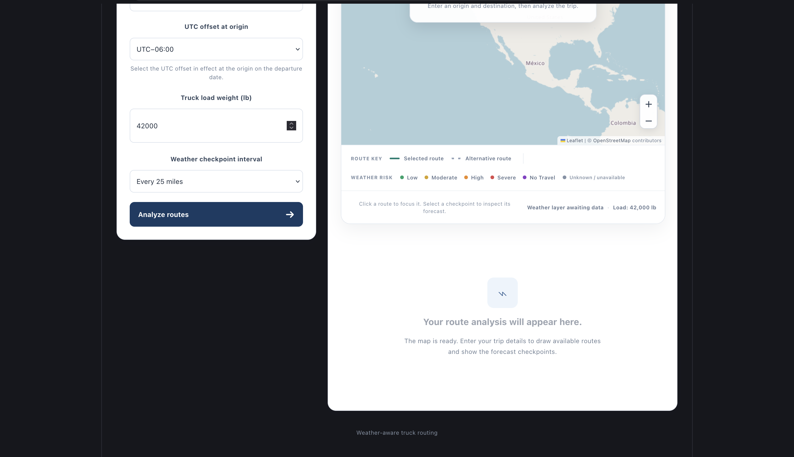
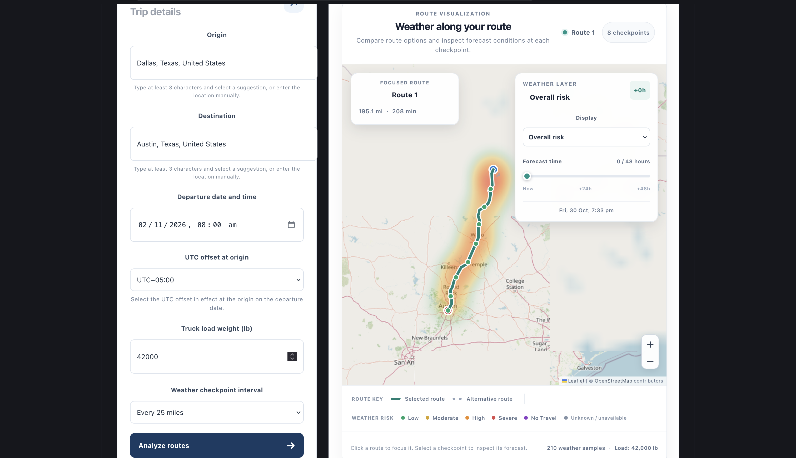
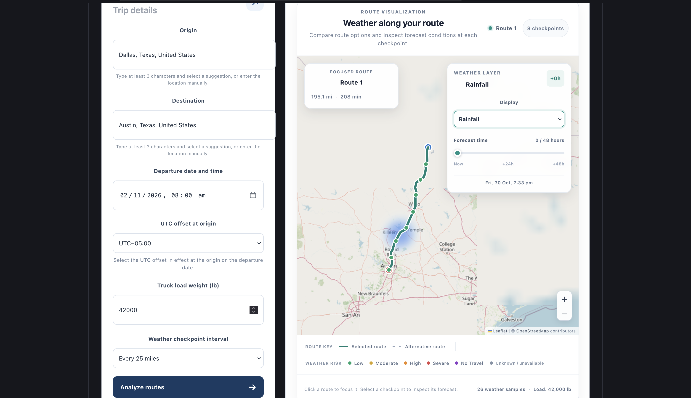
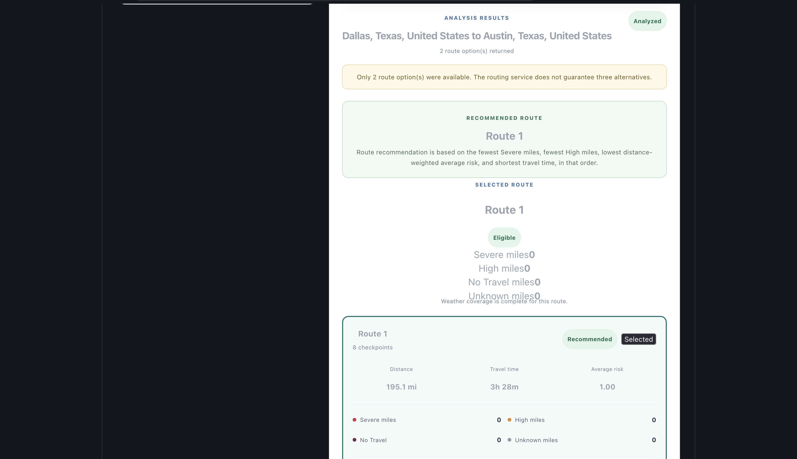
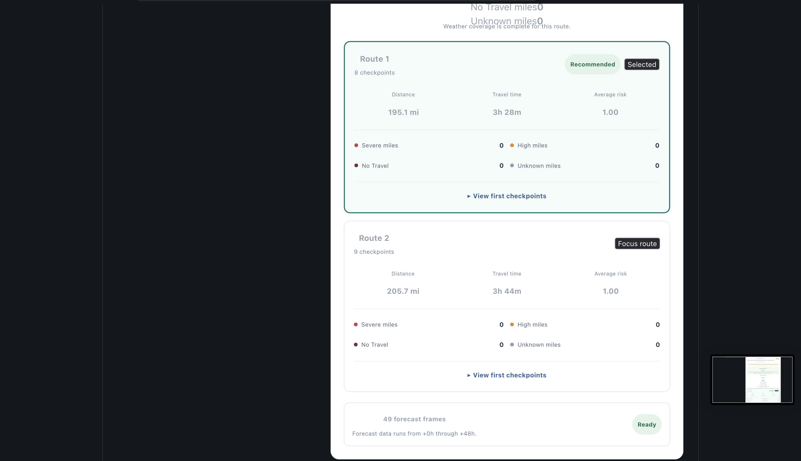
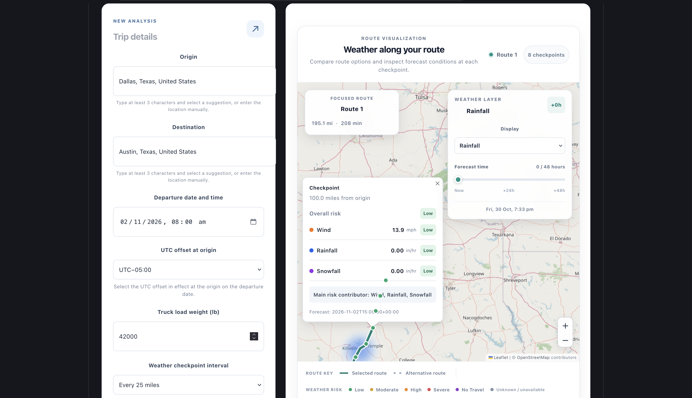
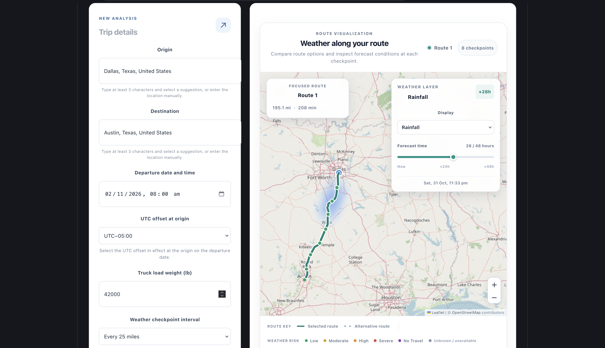
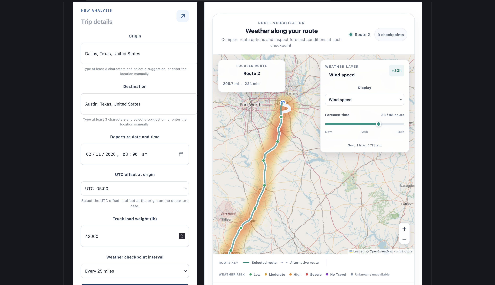

# Weather-Aware Truck Routing

A full-stack truck route analysis application that evaluates driving routes using weather forecasts, checkpoint-level risk assessment, and load-dependent safety rules.

The application generates alternative driving routes, samples weather conditions along each route, calculates weather risk based on wind, rainfall, snowfall, and truck load weight, and recommends the safest eligible route.

## Key Features

- **Multiple route alternatives:** Generate up to three driving route options.
- **Location autocomplete:** Search and select origin and destination locations.
- **Configurable checkpoints:** Sample weather every 10, 25, or 50 miles.
- **Weather forecasting:** Retrieve hourly wind, rainfall, and snowfall forecasts.
- **Load-dependent risk assessment:** Evaluate weather conditions using truck load weight.
- **Route scoring:** Calculate Severe miles, High miles, No Travel miles, Unknown miles, and distance-weighted average risk.
- **Intelligent route recommendation:** Rank routes according to risk severity and estimated travel duration.
- **Interactive map:** Display route geometry, alternative routes, and weather checkpoints.
- **Weather heatmap:** Explore risk, wind, rainfall, and snowfall along the route.
- **Forecast timeline:** Inspect hourly weather snapshots from 0 to 48 hours.
- **Error handling:** Handle invalid locations and external routing or weather provider failures.

## Technology Stack

### Frontend
- React
- TypeScript
- Vite
- React Leaflet
- Leaflet
- Leaflet.heat

### Backend
- Python
- Django
- Django REST Framework
- Requests

### External Services

| Service | Purpose |
|---|---|
| Nominatim | Address geocoding |
| Photon | Location autocomplete |
| OSRM | Driving route generation |
| Open-Meteo | Weather forecasts |
| OpenStreetMap | Map tiles |

## Architecture

The application follows a React frontend and Django REST API architecture.

```text
React + TypeScript Frontend
          |
          | HTTP / JSON
          v
Django REST API
          |
          +----------------------+
          |                      |
          v                      v
     Route Service          Weather Service
          |                      |
          v                      v
        OSRM                 Open-Meteo
          |
          v
       Nominatim
          |
          |
          v
   Checkpoint Sampling
          |
          v
   Weather Risk Analysis
          |
          v
     Route Scoring
          |
          v
   Route Recommendation
          |
          v
       API Response
          |
          v
     React Leaflet Map
```

### Analysis Workflow

1. The user selects an origin, destination, departure time, load weight, and checkpoint interval.
2. The backend resolves the origin and destination coordinates.
3. OSRM generates available driving route alternatives.
4. Each route is sampled at the selected checkpoint interval.
5. Checkpoint arrival times are estimated using route distance and duration.
6. Open-Meteo provides hourly weather forecasts for the checkpoint coordinates.
7. The backend evaluates wind, rainfall, and snowfall risk at each checkpoint's estimated arrival time.
8. Checkpoint risk is aggregated into route-level metrics.
9. Eligible routes are ranked using the recommendation priority rules.
10. The frontend displays route alternatives, checkpoint weather details, and the interactive weather heatmap.

## Weather Risk Assessment

The application evaluates three weather variables.

### Wind Risk

Wind risk depends on wind speed and truck load weight.

| Condition | Risk |
|---|---|
| Below 25 mph | Low |
| 25 to below 35 mph | Moderate |
| 35 to below 45 mph | High, or Severe when load exceeds 40,000 lb |
| 45 to below 55 mph | Severe, or No Travel when load exceeds 30,000 lb |
| 55 mph or higher | No Travel |

### Rainfall Risk

Rainfall values are measured in inches per hour.

| Rainfall | Risk |
|---|---|
| Below 0.10 | Low |
| 0.10 to below 0.25 | Moderate |
| 0.25 to below 0.50 | High |
| 0.50 to 1.00 | Severe |
| Above 1.00 | No Travel |

### Snowfall Risk

Snowfall values are measured in inches per hour.

| Snowfall | Risk |
|---|---|
| Below 0.50 | Low |
| 0.50 to below 1.00 | Moderate |
| 1.00 to below 2.00 | High |
| 2.00 to 3.00 | Severe |
| Above 3.00 | No Travel |

### Overall Checkpoint Risk

The highest applicable individual weather risk determines the overall checkpoint risk.

Missing weather measurements are treated as Unknown unless a No Travel condition is present.

## Route Recommendation

Only routes with complete weather coverage and no No Travel conditions are eligible for recommendation.

The ranking follows this priority order:

1. Fewest Severe miles.
2. Fewest High miles.
3. Lowest distance-weighted average risk score.
4. Shortest estimated travel duration.

If no route is eligible, the recommendation is returned as null.

### Distance-Weighted Average Risk

Checkpoint risk is assigned to the road segment ending at that checkpoint.

The average route risk is calculated using segment distances rather than treating every checkpoint as equally weighted.

## Weather Heatmap

The map provides four display modes:

| Mode | Visualization |
|---|---|
| Overall Risk | Risk severity gradient |
| Wind | Wind intensity gradient |
| Rain | Rainfall intensity gradient |
| Snow | Snowfall intensity gradient |

The forecast slider provides hourly weather snapshots from hour 0 through hour 48.

The heatmap is generated from sampled checkpoint weather and interpolation along the route corridor. It is not a continuous meteorological weather grid.

The heatmap timeline is referenced to the backend's forecast reference time, while route risk calculations use estimated checkpoint arrival times.

## Getting Started

### Prerequisites

- Python
- Node.js and npm
- Git

### 1. Clone the repository

```bash
git clone https://github.com/WaryArchanid/weather-aware-truck-routing.git

cd weather-aware-truck-routing
```

### 2. Backend Setup

Navigate to the backend:

```bash
cd backend
```

Create and activate a Python virtual environment:

```bash
python3 -m venv .venv

source .venv/bin/activate
```

Install Python dependencies:

```bash
pip install -r requirements.txt
```

Create your environment file:

```bash
cp .env.example .env
```

Update the environment values as needed:

```env
NOMINATIM_URL=https://nominatim.openstreetmap.org/search
OSRM_URL=https://router.project-osrm.org
NOMINATIM_USER_AGENT=WeatherAwareTruckRoutingAssessment/1.0 (contact: your-email@example.com)
MAX_FORECAST_DISTANCE_SECONDS=1800
```

Replace the example contact address with an appropriate contact address.

Run Django checks:

```bash
python manage.py check
```

Start the backend:

```bash
python manage.py runserver
```

Backend URL:

`http://127.0.0.1:8000`

Health endpoint:

`GET /api/health/`

### 3. Frontend Setup

Open another terminal:

```bash
cd frontend
```

Install dependencies:

```bash
npm install
```

Create the frontend environment file:

```bash
touch .env.local
```

Add:

```env
VITE_API_BASE_URL=http://127.0.0.1:8000
```

Start the development server:

```bash
npm run dev
```

Frontend URL:

`http://localhost:5173`

## API Reference

### Analyze Routes

**Endpoint**

`POST /api/routes/analyze/`

**Request Body**

```json
{
  "origin": "Seattle, WA",
  "destination": "Missoula, MT",
  "departure_datetime": "2026-11-15T08:00:00-07:00",
  "load_weight": 42000,
  "checkpoint_interval_miles": 25
}
```

### Request Parameters

| Parameter | Type | Description |
|---|---|---|
| origin | string | Starting location |
| destination | string | Destination location |
| departure_datetime | datetime | Timezone-aware departure time |
| load_weight | integer | Truck load weight in pounds |
| checkpoint_interval_miles | integer | Sampling interval: 10, 25, or 50 miles |

The response includes route alternatives, checkpoint weather and risk information, route summaries, a recommended route ID, and hourly heatmap frames.

## Running Automated Tests

The backend tests are organized under:

```text
backend/routing/tests/
```

Run the complete test suite:

```bash
python manage.py test routing.tests -v 2
```

The tests cover:

- Weather risk thresholds.
- Load-dependent wind risk.
- Checkpoint risk aggregation.
- Missing weather handling.
- Route scoring and distance weighting.
- Route recommendation and tie-breaking.
- Weather forecast frame generation.
- Timezone handling and checkpoint alignment.
- Weather provider failures.
- Routing provider failures.
- API error handling.

The provider tests use mocked HTTP responses to avoid depending on external service availability.

## External Service Limitations

This project uses public external services.

- **OSRM:** The public routing service provides general driving routes. It does not guarantee truck-specific restrictions, vehicle dimensions, weight restrictions, or live traffic-aware travel estimates. It may also return fewer than three route alternatives.
- **Nominatim:** Public geocoding usage is subject to its usage policy and request limits.
- **Photon:** Public autocomplete availability and usage are subject to its service policy.
- **Open-Meteo:** Weather availability depends on forecast coverage, location, and requested timestamps.
- **OpenStreetMap:** Map tiles are provided through the standard OpenStreetMap tile service and require adherence to its usage policy.

These providers are used for assessment and demonstration purposes. Production deployments should evaluate provider capacity, service terms, rate limits, and suitable alternatives.

## Project Structure

```text
weather-aware-truck-routing/
│
├── backend/
│   ├── config/
│   ├── routing/
│   │   ├── tests/
│   │   ├── checkpoints.py
│   │   ├── geometry.py
│   │   ├── risk.py
│   │   ├── services.py
│   │   ├── weather.py
│   │   └── views.py
│   ├── manage.py
│   ├── requirements.txt
│   └── .env.example
│
├── frontend/
│   ├── src/
│   ├── package.json
│   ├── package-lock.json
│   └── .env.example
│
├── .gitignore
└── README.md
```

## Future Improvements

- Truck-specific routing with vehicle dimensions and road restrictions.
- Live traffic-aware route duration estimates.
- More advanced weather risk prediction.
- Continuous weather-grid visualization.
- Additional forecast providers and fallback mechanisms.
- Deployment monitoring and observability.

## Application Screenshots

### Main Dashboard




### Route Analysis





### Checkpoint Weather Details


### Interactive Weather Heatmap

